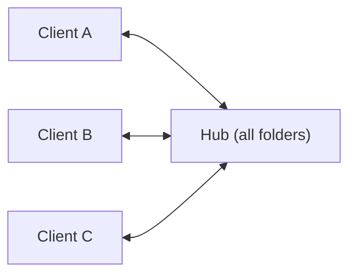
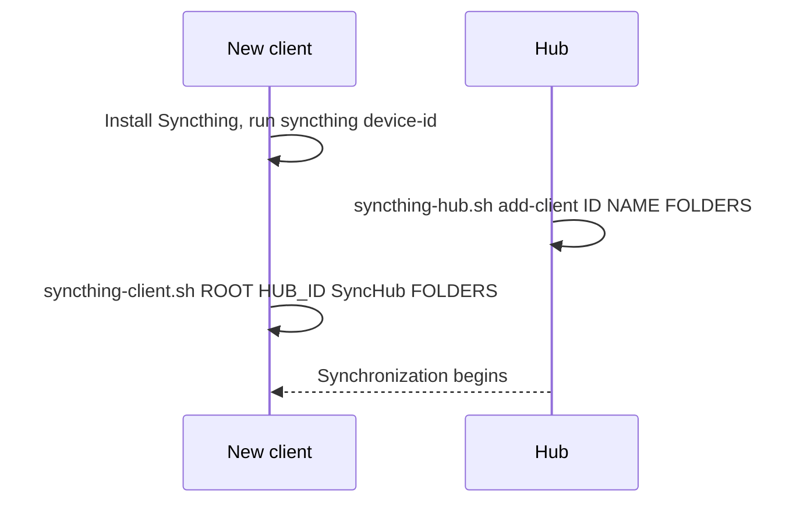
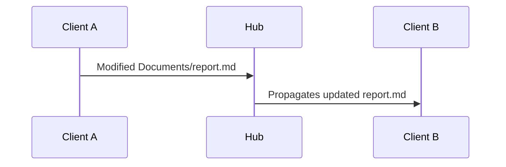

# syncthing-hub

Run [Syncthing](https://syncthing.net) as a **hub and spoke**, entirely from the terminal. One always-on Linux machine (the hub) holds every folder, and each client syncs only the folders it needs, through the hub.



Syncthing is peer-to-peer, so this layout is a deliberate choice. Each client is paired only with the hub, never with another client. The hub is the one place every change passes through, which makes it a natural spot for versioning and backups.

You describe the layout in one TOML file, and `bin/syncthing-hubspoke.py` sets up every machine over SSH. If you'd rather configure each machine by hand, see [Manual setup](#manual-setup-without-a-config-file).

- [How folders are matched across machines](#how-folders-are-matched-across-machines)
- [1. Install Syncthing](#1-install-syncthing)
- [2. Run Syncthing at boot](#2-run-syncthing-at-boot)
- [3. Configure everything with config.toml](#3-configure-everything-with-configtoml)
- [4. Move an existing setup over](#4-move-an-existing-setup-over)
- [5. Verify and test](#5-verify-and-test)
- [6. Firewall and remote administration](#6-firewall-and-remote-administration)
- [Manual setup without a config file](#manual-setup-without-a-config-file)
- [Troubleshooting](#troubleshooting)
- [Design notes](#design-notes)
- [Command reference](#command-reference)
- [Repository layout](#repository-layout)

## How folders are matched across machines

Syncthing identifies a shared folder by its **folder ID**, not by its path. Paths can differ between machines, and only the ID has to match:

```text
Hub:      documents -> /srv/sync/Documents
Laptop:   documents -> /home/alice/Sync/Documents
Mac:      documents -> /Users/alice/Sync/Documents
```

The config lists folders by name, and the ID is the name in lowercase (`WorkNotes` → `worknotes`, `Active Reading` → `active-reading`). Don't rename a folder once machines are syncing, because that changes its ID.

## 1. Install Syncthing

### Debian / Ubuntu

The official APT repository keeps you on the current stable v2 release:

```bash
sudo apt-get update
sudo apt-get install -y curl ca-certificates

sudo mkdir -p /etc/apt/keyrings
sudo curl -L -o /etc/apt/keyrings/syncthing-archive-keyring.gpg https://syncthing.net/release-key.gpg

echo "deb [signed-by=/etc/apt/keyrings/syncthing-archive-keyring.gpg] https://apt.syncthing.net/ syncthing stable-v2" \
  | sudo tee /etc/apt/sources.list.d/syncthing.list

sudo apt-get update
sudo apt-get install -y syncthing
syncthing --version
```

### Fedora / Arch

```bash
sudo dnf install syncthing      # Fedora
sudo pacman -S syncthing        # Arch
```

### macOS

Use **one** of these, not both. Two installs would run two copies of Syncthing that fight over the same settings.

- **Homebrew:** `brew install syncthing`, then start it now and at login with `brew services start syncthing`.
- **The Syncthing app (`Syncthing.app`):** it bundles the `syncthing` program but doesn't put it on your `PATH`, so link it once:

  ```bash
  ln -s /Applications/Syncthing.app/Contents/Resources/syncthing/syncthing /opt/homebrew/bin/syncthing
  ```

Check either way with `syncthing device-id`.

## 2. Run Syncthing at boot

On an always-on Linux hub, use the system service for your normal (non-root) account:

```bash
sudo systemctl enable --now syncthing@YOUR_USERNAME.service
sudo systemctl status syncthing@YOUR_USERNAME.service
journalctl -f -u syncthing@YOUR_USERNAME.service      # follow logs
```

Or use a per-user service that keeps running after you log out:

```bash
systemctl --user enable --now syncthing.service
sudo loginctl enable-linger "$USER"
```

Headless Linux clients can use either option. On macOS, Homebrew or the app starts Syncthing at login.

> [!WARNING]
> Run `syncthing cli ...` as the same user that runs the Syncthing instance. Don't use `sudo`, which points the CLI at a different user's configuration.

Prepare the hub's storage directory:

```bash
sudo mkdir -p /srv/sync
sudo chown "$USER":"$(id -gn)" /srv/sync
```

## 3. Configure everything with config.toml

### Requirements

- Syncthing running on every machine, under the account you will SSH into.
- Key-based SSH from the machine you run the tool on to every other machine. The tool never prompts for passwords (`ssh-copy-id user@host` sets this up).
- Python 3.11 or newer on the machine you run the tool on. Older Python, including the `python3` built into macOS, needs `python3 -m pip install --user tomli` first.

### Write the config

```bash
cp config.example.toml config.toml      # config.toml is git-ignored
```

```toml
[hub]
name = "Host"
ssh = "alice@100.64.0.3"
path = "/srv/sync"
folders = ["Archive", "Documents", "Photos", "WorkNotes", "WritingNotes"]

[clients.macbook]
ssh = "local"                              # the machine you run the tool on
path = "~/Sync"
folders = ["Documents", "Photos", "WritingNotes"]
paths = { Photos = "~/Pictures/Synced" }   # optional per-folder location

[clients.laptop]
ssh = "alice@100.64.0.4"
path = "/srv/sync"
folders = ["Archive", "Documents", "WorkNotes"]
```

| Key | Meaning |
|---|---|
| `ssh` | How to reach the machine, using the account that runs Syncthing there. Use `"local"` for the machine you run the tool on; only one machine can be `local`. A machine that runs the tool but doesn't sync needs no entry. |
| `path` | Each folder lives at `path/<folder name>`. `~` expands to that machine's own home directory. |
| `folders` | Folder names. Every client folder must also be in the hub's list. |
| `paths` | Optional. Put individual folders somewhere other than `path/<folder name>`. |
| `id` | Optional device ID. The tool reads device IDs over SSH, so you only need this for a machine that may be offline when you run `apply`. If you set it, the tool also checks it against the machine it reaches. |

The tool rejects typos (unknown keys, bad device IDs, client folders the hub doesn't have) before it touches anything.

### Inspect, then apply

```bash
python3 bin/syncthing-hubspoke.py inspect config.toml           # show state and what would change
python3 bin/syncthing-hubspoke.py apply config.toml             # make every machine match
python3 bin/syncthing-hubspoke.py apply config.toml laptop      # one machine only
```

`apply` reads every machine's device ID first, then sets up the hub, then each client:

- **pairs devices:** the hub with every client, each client with the hub only;
- **creates folders** and shares each one with the right devices;
- **sets device names and folder labels**, and turns off `introducer`.

`apply` only adds and updates, and running it again is safe. Anything that would remove or move something is printed with the machine to run it on, and is never run automatically.

`inspect` shows each machine's devices (with connection status), its folders (with who they're shared with), and its findings:

| Tag | Meaning |
|---|---|
| `ADD`, `SET`, `SHARE` | What `apply` will do. |
| `MIGRATE` | A folder under another ID that should be re-created under the standard one. |
| `EXTRA` | A device, share or duplicate folder the config doesn't call for, with the command to remove it. |
| `KEEP` | A folder that exists somewhere other than the config path; it's left there. |
| `WARN`, `INFO` | Things to look at; nothing to run. |

Run `inspect` with no config to report just the machine you're on. That's useful before you write the config.

To change the layout later (a new client, a different folder set), edit `config.toml` and run `apply` again.

## 4. Move an existing setup over

Machines that already sync are brought into the layout in place. Typically they're all paired with each other, use random folder IDs and have introducers turned on. The tool matches existing folders to the config by ID, label or directory name, so `Work Notes`, `worknotes` and `WorkNotes` all match.

1. Write `config.toml`, then run `inspect config.toml`.
2. Run `apply config.toml`.
3. Run the `MIGRATE` commands it prints, on the machine named above them (hub first).
4. Once the hub has a full copy of the data, run the `EXTRA` commands to remove client-to-client links and duplicate folders.
5. Repeat `inspect config.toml` until every machine reports `Nothing to do`.

Re-creating a folder under a new ID keeps the files on disk, and Syncthing doesn't re-transfer files that are already identical. Do it on every device that shares the folder. Until a device is migrated, the new ID shows up there as a pending folder. File versioning settings aren't carried over, and `inspect` warns you when a folder had them.

> [!WARNING]
> Have a backup before migrating, and remove client-to-client links only after the hub has a full copy of the data.

Syncthing happily configures two folder IDs on one directory, so neither the tool nor the helper scripts will ever add a folder on a directory that another folder ID already uses.

## 5. Verify and test

```bash
python3 bin/syncthing-hubspoke.py inspect config.toml
```

Or check one machine by hand:

```bash
syncthing cli show connections
syncthing cli show pending folders
syncthing cli config folders documents devices list
```

Then test both directions:

```bash
echo "hello from $(hostname)" > ~/Sync/Documents/syncthing-test.txt    # on a client
cat /srv/sync/Documents/syncthing-test.txt                             # on the hub
echo "hello from hub" > /srv/sync/Documents/hub-test.txt               # on the hub; check the client
```

If there are no unexpected pending folders and every client is connected to the hub, the setup is complete.

## 6. Firewall and remote administration

Syncthing uses:

| Port | Protocol | Purpose |
|---|---|---|
| `22000` | TCP | sync protocol |
| `22000` | UDP | QUIC sync protocol |
| `21027` | UDP | local discovery |

```bash
sudo ufw allow syncthing                                              # UFW
sudo firewall-cmd --zone=public --add-service=syncthing --permanent   # firewalld
sudo firewall-cmd --reload
```

Don't expose TCP `8384`, the web GUI and API. It's bound to localhost by default, and you can still reach it through an SSH tunnel when you need it:

```bash
ssh -L 8385:localhost:8384 user@your-hub      # then open http://localhost:8385
```

## Manual setup without a config file

`bin/syncthing-hub.sh` and `bin/syncthing-client.sh` set up a single machine by hand, for the five default folders `Archive`, `Documents`, `Photos`, `WorkNotes` and `WritingNotes`. Copy them to `~/bin/` on the machine and run them as the Syncthing user. Both are safe to re-run.

**On the hub:**

```bash
~/bin/syncthing-hub.sh init /srv/sync           # create all five folders under /srv/sync
syncthing device-id                             # give this to each client

~/bin/syncthing-hub.sh add-client CLIENT_DEVICE_ID macbook Documents Photos WritingNotes
~/bin/syncthing-hub.sh status
```

**On each client:**

```bash
syncthing device-id                             # register this on the hub first
~/bin/syncthing-client.sh "$HOME/Sync" HUB_DEVICE_ID SyncHub Documents Photos WritingNotes
```

The client script adds the hub as a device, creates the same folder IDs locally, and shares them back to the hub. Sharing them back is what clears them from the pending list.

To add a machine later, run `add-client` on the hub for it, then run the client script on the new machine:



## Troubleshooting

**A folder stays pending.** A remote device offered it, but this machine hasn't configured that folder ID and shared it back. If the folder exists locally, check that the hub is attached to it:

```bash
syncthing cli config folders photos devices list
syncthing cli config folders photos devices add --device-id "$HUB_ID"
```

**`folder "photos": folder has duplicate ID`.** The folder already exists, so don't add it again. Inspect it and attach the hub if needed:

```bash
syncthing cli config folders photos dump-json
syncthing cli config folders photos path get
```

**Two folder IDs on one directory.** `inspect` reports these as `EXTRA` with the command to remove the one that doesn't match the config. Removing a folder's configuration never deletes its files.

**`syncthing: command not found` over SSH.** The tool already adds `/opt/homebrew/bin` and `/usr/local/bin` to `PATH` on remote machines. For other locations, link the program into one of those directories.

**Removing a folder from a client.** Stopping sync and deleting files are separate steps. Unshare it on the hub (`syncthing cli config folders photos devices DEVICE_ID delete`), then remove the folder configuration on the client if you want. Check your data before deleting any directory.

## Design notes

**Keep folders Send & Receive** (the default) for anything people edit. A change on one client goes to the hub, and the hub passes it on:



If the hub is offline, changes wait on the client where they were made until the hub is back.

**Don't enable Introducer on the hub.** An introducer teaches clients about the hub's other devices, which recreates client-to-client links. `apply` turns it off.

**Syncthing is not a backup.** A deletion or a bad edit syncs as faithfully as a good one. For important folders, add at least one of:

- Syncthing file versioning on the hub;
- filesystem snapshots;
- a separate backup system;
- an offline or immutable copy.

```text
Syncthing = availability + replication
Backup    = recovery from deletion, corruption, mistakes, or compromise
```

## Command reference

```bash
syncthing device-id                                   # this device's ID
syncthing cli config devices list                     # paired devices
syncthing cli config folders list                     # folder IDs
syncthing cli config folders documents dump-json      # one folder's full config
syncthing cli config folders documents path get
syncthing cli config folders documents devices list   # who shares it
syncthing cli show connections
syncthing cli show pending devices
syncthing cli show pending folders
syncthing cli config folders --help                   # exact syntax for your version
journalctl --user -f -u syncthing.service             # logs (user service)
```

## Repository layout

| Path | What it is |
|---|---|
| `bin/syncthing-hubspoke.py` | The config-driven tool (`apply`, `inspect`) |
| `config.example.toml` | Commented config template |
| `bin/syncthing-hub.sh`, `bin/syncthing-client.sh` | Simpler scripts for setting up one machine by hand |
| `tests/test_hubspoke.py` | Tests for config parsing and planning: `python3 -m pytest tests` or `python3 tests/test_hubspoke.py` |
