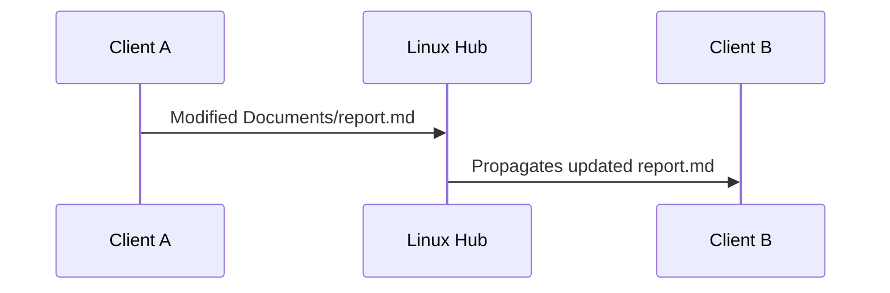
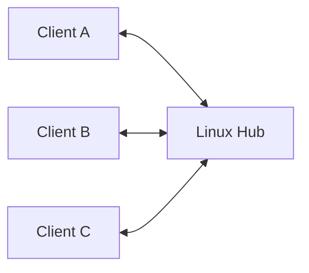
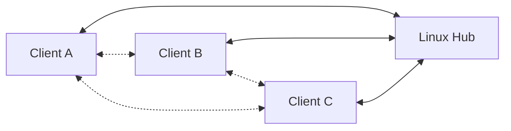
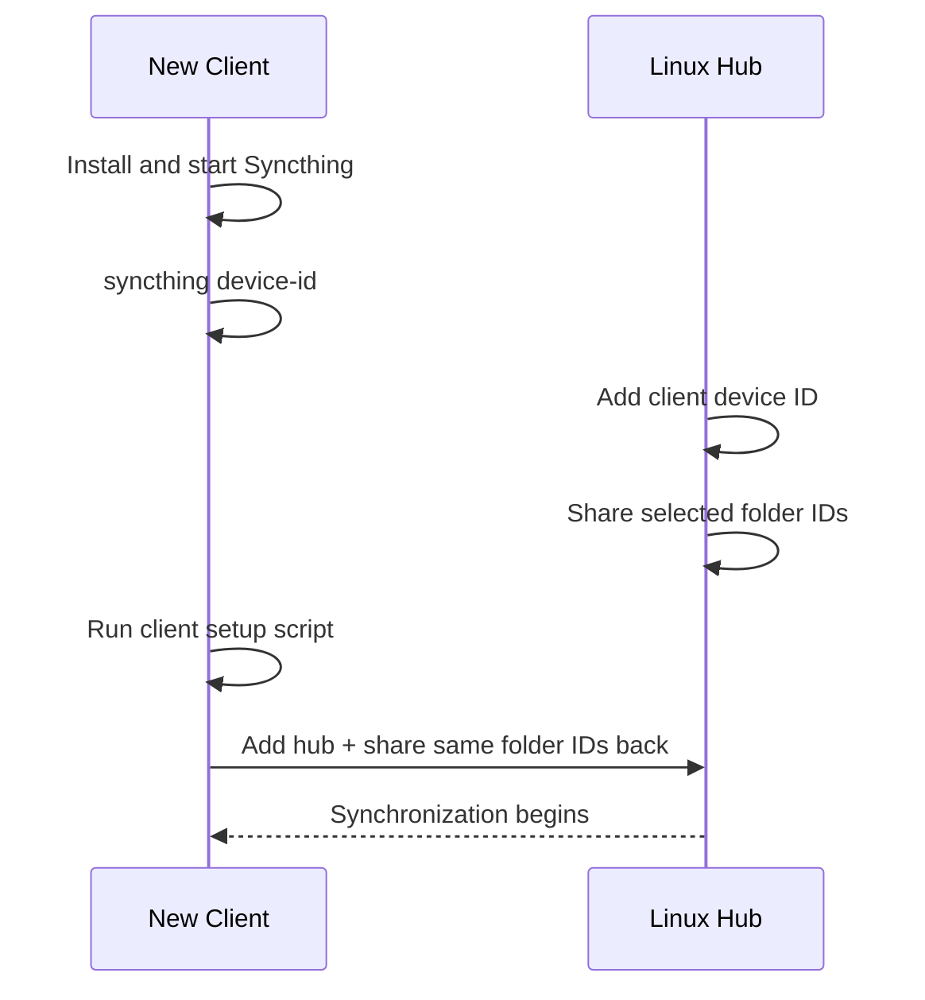

# Syncthing Headless Hub-and-Spoke Setup

This note documents a **terminal-only Syncthing setup** with one Linux machine acting as the central hub.

The hub stores all five data sets:

- `Archive`
- `Documents`
- `Photos`
- `WorkNotes`
- `WritingNotes`

Each client is paired only with the Linux hub and receives only the subset of folders assigned to it.

> [!important]
> Syncthing is technically peer-to-peer. This guide deliberately configures it as a **hub-and-spoke topology** by pairing clients only with the Linux hub and not with one another.

## Architecture

![[syncthing.excalidraw]]

Do **not** pair the clients with each other.

## Folder IDs

Syncthing identifies a shared folder by its **folder ID**, not by its local filesystem path.

Use these IDs consistently on every machine:

| Folder | Syncthing folder ID |
|---|---|
| `Archive` | `archive` |
| `Documents` | `documents` |
| `Photos` | `photos` |
| `WorkNotes` | `worknotes` |
| `WritingNotes` | `writingnotes` |

The paths can differ between machines.

Example:

```text
Hub:
  documents -> /srv/sync/Documents

Linux laptop:
  documents -> /home/alice/Sync/Documents

Mac:
  documents -> /Users/alice/Sync/Documents
```

As long as the folder ID is `documents` on all participating devices, those paths belong to the same Syncthing folder.

---

# 1. Install Syncthing on the Linux hub

## Debian / Ubuntu

For a server, using the current Syncthing APT repository is a good way to stay on the current stable v2 release channel.

Install prerequisites:

```bash
sudo apt-get update
sudo apt-get install -y curl ca-certificates
```

Install the Syncthing signing key:

```bash
sudo mkdir -p /etc/apt/keyrings

sudo curl -L \
  -o /etc/apt/keyrings/syncthing-archive-keyring.gpg \
  https://syncthing.net/release-key.gpg
```

Add the stable v2 repository:

```bash
echo "deb [signed-by=/etc/apt/keyrings/syncthing-archive-keyring.gpg] https://apt.syncthing.net/ syncthing stable-v2" \
  | sudo tee /etc/apt/sources.list.d/syncthing.list
```

Install Syncthing:

```bash
sudo apt-get update
sudo apt-get install -y syncthing
```

Check it:

```bash
syncthing --version
```

## Fedora

```bash
sudo dnf install syncthing
```

## Arch Linux

```bash
sudo pacman -S syncthing
```

---

# 2. Run Syncthing on the hub at boot

For a Linux machine acting as an always-on server, use the system-level service for your normal non-root account.

Check your username:

```bash
whoami
```

Then enable the service, replacing `YOUR_USERNAME` if necessary:

```bash
sudo systemctl enable --now syncthing@YOUR_USERNAME.service
```

For example:

```bash
sudo systemctl enable --now syncthing@alice.service
```

Check status:

```bash
sudo systemctl status syncthing@YOUR_USERNAME.service
```

View logs:

```bash
journalctl -e -u syncthing@YOUR_USERNAME.service
```

Follow logs live:

```bash
journalctl -f -u syncthing@YOUR_USERNAME.service
```

> [!warning]
> Run `syncthing cli ...` as the same user that owns/runs the Syncthing instance. Do not casually run the CLI with `sudo`, because that can point it at a different user's Syncthing configuration.

## Alternative: user service plus lingering

If you prefer a per-user systemd service:

```bash
systemctl --user enable --now syncthing.service
sudo loginctl enable-linger "$USER"
```

Check it:

```bash
systemctl --user status syncthing.service
```

---

# 3. Prepare the hub storage

This guide uses:

```text
/srv/sync
```

Create it and give your Syncthing user ownership:

```bash
sudo mkdir -p /srv/sync
sudo chown "$USER":"$(id -gn)" /srv/sync
```

The final hub layout will be:

```text
/srv/sync/
├── Archive/
├── Documents/
├── Photos/
├── WorkNotes/
└── WritingNotes/
```

---

# 4. Get the hub device ID

Run:

```bash
syncthing device-id
```

Save the output somewhere secure/convenient.

You can also put it in a shell variable:

```bash
HUB_ID="$(syncthing device-id)"
echo "$HUB_ID"
```

A Syncthing device ID looks similar to:

```text
AAAAAAA-BBBBBBB-CCCCCCC-DDDDDDD-EEEEEEE-FFFFFFF-GGGGGGG-HHHHHHH
```

---

# 5. Install the hub helper script

Save the following as:

```text
~/bin/syncthing-hub.sh
```

```bash
#!/usr/bin/env bash
set -euo pipefail

ALL_FOLDERS=(Archive Documents Photos WorkNotes WritingNotes)

die() {
    echo "ERROR: $*" >&2
    exit 1
}

folder_id() {
    case "$1" in
        Archive)      echo "archive" ;;
        Documents)    echo "documents" ;;
        Photos)       echo "photos" ;;
        WorkNotes)    echo "worknotes" ;;
        WritingNotes) echo "writingnotes" ;;
        *) die "Unknown folder '$1'. Allowed: ${ALL_FOLDERS[*]}" ;;
    esac
}

require_syncthing() {
    command -v syncthing >/dev/null 2>&1 || die "syncthing is not installed or not in PATH"
    syncthing cli show system >/dev/null 2>&1 ||
        die "Syncthing is not running for this user"
}

# Capture output before grepping: `cmd | grep -q` under pipefail can fail with
# SIGPIPE when grep exits early, which would look like "not found".
list_contains() {
    local needle="$1" out
    shift
    out="$("$@")" || die "Command failed: $*"
    grep -Fxq -- "$needle" <<<"$out"
}

device_exists() {
    list_contains "$1" syncthing cli config devices list
}

folder_exists() {
    list_contains "$1" syncthing cli config folders list
}

folder_has_device() {
    list_contains "$2" syncthing cli config folders "$1" devices list
}

# Syncthing happily configures two folder IDs on one directory, so check first.
folder_at_path() {
    local path="$1" ids id
    ids="$(syncthing cli config folders list)" || die "Command failed: syncthing cli config folders list"
    for id in $ids; do
        if [[ "$(syncthing cli config folders "$id" path get)" == "$path" ]]; then
            echo "$id"
            return
        fi
    done
}

ensure_folder() {
    local root="$1"
    local name="$2"
    local id path current_path other

    id="$(folder_id "$name")"
    path="${root%/}/$name"

    if folder_exists "$id"; then
        current_path="$(syncthing cli config folders "$id" path get)"
        syncthing cli config folders "$id" label set "$name" >/dev/null
        if [[ "$current_path" == "$path" ]]; then
            echo "[OK] $name ($id) -> $path"
        else
            echo "[KEEP] $name ($id) -> $current_path (not under $(dirname "$path"); left where it is)"
        fi
    else
        other="$(folder_at_path "$path")"
        [[ -z "$other" ]] ||
            die "Folder '$other' already uses '$path'. Run syncthing-inspect.py to migrate it to ID '$id'."
        mkdir -p "$path"
        syncthing cli config folders add \
            --id "$id" \
            --label "$name" \
            --path "$path"
        echo "[ADD] $name ($id) -> $path"
    fi
}

cmd_init() {
    [[ $# -eq 1 ]] || die "Usage: $0 init SYNC_ROOT"
    local root="${1%/}"

    mkdir -p "$root"

    for name in "${ALL_FOLDERS[@]}"; do
        ensure_folder "$root" "$name"
    done

    echo
    echo "Hub initialized."
    echo "Device ID:"
    syncthing device-id
}

cmd_add_client() {
    [[ $# -ge 3 ]] || die "Usage: $0 add-client DEVICE_ID DEVICE_NAME FOLDER [FOLDER ...]"

    local device_id="$1"
    local device_name="$2"
    shift 2

    if device_exists "$device_id"; then
        echo "[OK] Device already configured: $device_name"
        syncthing cli config devices "$device_id" name set "$device_name" >/dev/null || true
    else
        syncthing cli config devices add \
            --device-id "$device_id" \
            --name "$device_name"
        echo "[ADD] Device: $device_name"
    fi

    local name id
    for name in "$@"; do
        id="$(folder_id "$name")"

        folder_exists "$id" ||
            die "Hub folder '$id' is not configured. Run '$0 init /your/sync/root' first."

        if folder_has_device "$id" "$device_id"; then
            echo "[OK] $name already shared with $device_name"
        else
            syncthing cli config folders "$id" devices add \
                --device-id "$device_id"
            echo "[SHARE] $name -> $device_name"
        fi
    done

    echo
    echo "Client configured on hub."
}

cmd_status() {
    echo "Local device ID:"
    syncthing device-id
    echo
    echo "Devices:"
    syncthing cli config devices list
    echo
    echo "Folders:"
    syncthing cli config folders list
    echo
    echo "Connections:"
    syncthing cli show connections
}

require_syncthing

case "${1:-}" in
    init)
        shift
        cmd_init "$@"
        ;;
    add-client)
        shift
        cmd_add_client "$@"
        ;;
    status)
        shift
        cmd_status "$@"
        ;;
    *)
        cat >&2 <<EOF
Usage:
  $0 init SYNC_ROOT
  $0 add-client DEVICE_ID DEVICE_NAME FOLDER [FOLDER ...]
  $0 status

Folders:
  Archive Documents Photos WorkNotes WritingNotes
EOF
        exit 1
        ;;
esac
```

Make it executable:

```bash
mkdir -p ~/bin
chmod +x ~/bin/syncthing-hub.sh
```

If `~/bin` is not in your `PATH`, run it using its full path.

---

# 6. Initialize all five folders on the hub

Run:

```bash
~/bin/syncthing-hub.sh init /srv/sync
```

Check:

```bash
syncthing cli config folders list
```

Expected IDs:

```text
archive
documents
photos
worknotes
writingnotes
```

Inspect any folder:

```bash
syncthing cli config folders photos dump-json
```

Check its path:

```bash
syncthing cli config folders photos path get
```

---

# 7. Install Syncthing on a Linux client

Install it using the same distro-specific method as above.

For a headless Linux client, either use the system service:

```bash
sudo systemctl enable --now syncthing@YOUR_USERNAME.service
```

or use a user service plus lingering:

```bash
systemctl --user enable --now syncthing.service
sudo loginctl enable-linger "$USER"
```

Get the client device ID:

```bash
syncthing device-id
```

Example:

```bash
CLIENT_ID="$(syncthing device-id)"
echo "$CLIENT_ID"
```

---

# 8. Install Syncthing on a macOS client

With Homebrew:

```bash
brew install syncthing
```

Start it now and at login:

```bash
brew services start syncthing
```

Check:

```bash
syncthing --version
syncthing device-id
```

The same client configuration script in this document can be used on macOS.

---

# 9. Register a client on the hub

Suppose a Mac should receive:

- `Documents`
- `Photos`
- `WritingNotes`

On the hub:

```bash
MAC_ID="PASTE-MAC-DEVICE-ID-HERE"
```

Then:

```bash
~/bin/syncthing-hub.sh add-client \
  "$MAC_ID" \
  macbook \
  Documents Photos WritingNotes
```

A Linux laptop might get:

- `Archive`
- `Documents`
- `WorkNotes`

On the hub:

```bash
LAPTOP_ID="PASTE-LINUX-LAPTOP-DEVICE-ID-HERE"

~/bin/syncthing-hub.sh add-client \
  "$LAPTOP_ID" \
  laptop \
  Archive Documents WorkNotes
```

The hub holds all folders, but only shares the chosen subset with each client.

---

# 10. Install the client helper script

Save this as:

```text
~/bin/syncthing-client.sh
```

```bash
#!/usr/bin/env bash
set -euo pipefail

ALL_FOLDERS=(Archive Documents Photos WorkNotes WritingNotes)

die() {
    echo "ERROR: $*" >&2
    exit 1
}

folder_id() {
    case "$1" in
        Archive)      echo "archive" ;;
        Documents)    echo "documents" ;;
        Photos)       echo "photos" ;;
        WorkNotes)    echo "worknotes" ;;
        WritingNotes) echo "writingnotes" ;;
        *) die "Unknown folder '$1'. Allowed: ${ALL_FOLDERS[*]}" ;;
    esac
}

require_syncthing() {
    command -v syncthing >/dev/null 2>&1 || die "syncthing is not installed or not in PATH"
    syncthing cli show system >/dev/null 2>&1 ||
        die "Syncthing is not running for this user"
}

# Capture output before grepping: `cmd | grep -q` under pipefail can fail with
# SIGPIPE when grep exits early, which would look like "not found".
list_contains() {
    local needle="$1" out
    shift
    out="$("$@")" || die "Command failed: $*"
    grep -Fxq -- "$needle" <<<"$out"
}

device_exists() {
    list_contains "$1" syncthing cli config devices list
}

folder_exists() {
    list_contains "$1" syncthing cli config folders list
}

folder_has_device() {
    list_contains "$2" syncthing cli config folders "$1" devices list
}

# Syncthing happily configures two folder IDs on one directory, so check first.
folder_at_path() {
    local path="$1" ids id
    ids="$(syncthing cli config folders list)" || die "Command failed: syncthing cli config folders list"
    for id in $ids; do
        if [[ "$(syncthing cli config folders "$id" path get)" == "$path" ]]; then
            echo "$id"
            return
        fi
    done
}

[[ $# -ge 4 ]] || {
    cat >&2 <<EOF
Usage:
  $0 SYNC_ROOT HUB_DEVICE_ID HUB_NAME FOLDER [FOLDER ...]

Folders:
  Archive Documents Photos WorkNotes WritingNotes
EOF
    exit 1
}

require_syncthing

SYNC_ROOT="${1%/}"
HUB_ID="$2"
HUB_NAME="$3"
shift 3
FOLDERS=("$@")

mkdir -p "$SYNC_ROOT"

if device_exists "$HUB_ID"; then
    echo "[OK] Hub device already configured: $HUB_NAME"
    syncthing cli config devices "$HUB_ID" name set "$HUB_NAME" >/dev/null || true
else
    syncthing cli config devices add \
        --device-id "$HUB_ID" \
        --name "$HUB_NAME"
    echo "[ADD] Hub device: $HUB_NAME"
fi

for name in "${FOLDERS[@]}"; do
    id="$(folder_id "$name")"
    path="$SYNC_ROOT/$name"

    if folder_exists "$id"; then
        current_path="$(syncthing cli config folders "$id" path get)"

        syncthing cli config folders "$id" label set "$name" >/dev/null

        if [[ "$current_path" == "$path" ]]; then
            echo "[OK] $name ($id) -> $path"
        else
            echo "[KEEP] $name ($id) -> $current_path (not under $(dirname "$path"); left where it is)"
        fi
    else
        other="$(folder_at_path "$path")"
        [[ -z "$other" ]] ||
            die "Folder '$other' already uses '$path'. Run syncthing-inspect.py to migrate it to ID '$id'."
        mkdir -p "$path"
        syncthing cli config folders add \
            --id "$id" \
            --label "$name" \
            --path "$path"
        echo "[ADD] $name ($id) -> $path"
    fi

    if folder_has_device "$id" "$HUB_ID"; then
        echo "[OK] $name already shared back to hub"
    else
        syncthing cli config folders "$id" devices add \
            --device-id "$HUB_ID"
        echo "[ACCEPT] $name <-> $HUB_NAME"
    fi
done

echo
echo "Configuration complete."
echo
echo "Remaining pending folders:"
syncthing cli show pending folders
echo
echo "Connections:"
syncthing cli show connections
```

Make it executable:

```bash
mkdir -p ~/bin
chmod +x ~/bin/syncthing-client.sh
```

---

# 11. Configure a client

First copy the hub device ID:

```bash
HUB_ID="PASTE-HUB-DEVICE-ID-HERE"
```

## Example: Linux client using `/srv/sync`

If this machine should receive `Archive`, `Documents`, and `WorkNotes`:

```bash
sudo mkdir -p /srv/sync
sudo chown "$USER":"$(id -gn)" /srv/sync

~/bin/syncthing-client.sh \
  /srv/sync \
  "$HUB_ID" \
  SyncHub \
  Archive Documents WorkNotes
```

## Example: Linux client using `~/Sync`

```bash
~/bin/syncthing-client.sh \
  "$HOME/Sync" \
  "$HUB_ID" \
  SyncHub \
  Documents Photos
```

## Example: macOS

```bash
~/bin/syncthing-client.sh \
  "$HOME/Sync" \
  "$HUB_ID" \
  SyncHub \
  Documents Photos WritingNotes
```

The client script performs both sides of the local acceptance process:

1. adds the hub as a known device;
2. creates/configures the same folder ID locally;
3. shares that local folder back to the hub.

That final step is why the folder stops appearing as **pending**.

---

# 12. Understanding pending folders

List pending offers:

```bash
syncthing cli show pending folders
```

A pending folder means a remote device has offered a folder, but your local Syncthing instance has not yet configured that folder and shared it back to the offering device.

For example, if `photos` is already configured locally but remains pending, check whether the hub is attached:

```bash
syncthing cli config folders photos devices list
```

If the hub ID is missing:

```bash
syncthing cli config folders photos devices add \
  --device-id "$HUB_ID"
```

Then check again:

```bash
syncthing cli show pending folders
```

## Duplicate folder ID error

If you see:

```text
folder "photos": folder has duplicate ID
```

do **not** add the folder again.

Inspect it:

```bash
syncthing cli config folders photos dump-json
```

Check its path:

```bash
syncthing cli config folders photos path get
```

Then attach the hub if necessary:

```bash
syncthing cli config folders photos devices add \
  --device-id "$HUB_ID"
```

---

# 13. Verify the topology

On the hub:

```bash
~/bin/syncthing-hub.sh status
```

Or manually:

```bash
syncthing cli config devices list
syncthing cli config folders list
syncthing cli show connections
```

For a specific folder:

```bash
syncthing cli config folders documents dump-json
```

List devices sharing that folder:

```bash
syncthing cli config folders documents devices list
```

On a client:

```bash
syncthing cli show connections
syncthing cli show pending folders
syncthing cli config folders list
```

---

# 14. Test synchronization

Create a test file on a client:

```bash
echo "hello from client $(hostname)" > /srv/sync/Documents/syncthing-test.txt
```

Or if your client root is `~/Sync`:

```bash
echo "hello from client $(hostname)" > "$HOME/Sync/Documents/syncthing-test.txt"
```

On the hub:

```bash
cat /srv/sync/Documents/syncthing-test.txt
```

Then test the opposite direction:

```bash
echo "hello from hub" > /srv/sync/Documents/hub-test.txt
```

Verify it appears on the client.

---

# 15. Firewall

Syncthing normally uses:

| Port | Protocol | Purpose |
|---|---|---|
| `22000` | TCP | sync protocol |
| `22000` | UDP | QUIC sync protocol |
| `21027` | UDP | local discovery |

With UFW:

```bash
sudo ufw allow syncthing
```

Check:

```bash
sudo ufw status verbose
```

With firewalld:

```bash
sudo firewall-cmd --zone=public --add-service=syncthing --permanent
sudo firewall-cmd --reload
```

You normally do **not** need to expose TCP `8384`. That is the management/API interface and can remain bound to localhost.

---

# 16. Remote administration without exposing the GUI

Even though this setup is designed for CLI operation, you can temporarily tunnel the local Syncthing management interface over SSH.

From your workstation:

```bash
ssh -L 8385:localhost:8384 user@your-hub
```

Then the hub's localhost-only Syncthing interface is available through local port `8385`.

This does not require opening port `8384` on the hub firewall.

---

# 17. Recommended folder mode

For folders that users edit on their machines, use the default:

```text
Send & Receive
```

That allows this flow:



Because Client A and Client B are not paired directly, the hub is the practical propagation point in this topology.

If the hub is offline, changes remain on the originating client until the hub becomes available again.

---

# 18. Do not enable Introducer for this design

Keep the Linux hub configured as a normal device on clients.

Do **not** enable its `introducer` setting unless you intentionally want the hub to teach clients about other devices.

The desired topology is:



Not:



---

# 19. Useful terminal commands

## Device ID

```bash
syncthing device-id
```

## List configured devices

```bash
syncthing cli config devices list
```

## List folders

```bash
syncthing cli config folders list
```

## Folder details

```bash
syncthing cli config folders documents dump-json
```

## Folder path

```bash
syncthing cli config folders documents path get
```

## Devices sharing a folder

```bash
syncthing cli config folders documents devices list
```

## Connections

```bash
syncthing cli show connections
```

## Pending devices

```bash
syncthing cli show pending devices
```

## Pending folders

```bash
syncthing cli show pending folders
```

## Linux server logs

System service:

```bash
journalctl -f -u syncthing@YOUR_USERNAME.service
```

User service:

```bash
journalctl --user -f -u syncthing.service
```

## CLI help

```bash
syncthing cli --help
syncthing cli config --help
syncthing cli config folders --help
syncthing cli config devices --help
```

---

# 20. Adding a new machine later

The workflow is:



Example:

On the new client:

```bash
syncthing device-id
```

Take that ID to the hub:

```bash
NEW_ID="PASTE-NEW-DEVICE-ID"

~/bin/syncthing-hub.sh add-client \
  "$NEW_ID" \
  new-laptop \
  Documents WritingNotes
```

Then on the new client:

```bash
HUB_ID="PASTE-HUB-ID"

~/bin/syncthing-client.sh \
  "$HOME/Sync" \
  "$HUB_ID" \
  SyncHub \
  Documents WritingNotes
```

---

# 21. Removing a folder from a client

There are two separate decisions:

1. stop syncing the folder;
2. optionally delete the local files.

To stop sharing from the **hub**, inspect the folder/device configuration first:

```bash
syncthing cli config folders photos devices list
```

Use the CLI help for the installed Syncthing version to confirm the remove syntax:

```bash
syncthing cli config folders photos devices --help
```

After removing the client from that hub folder, remove the local Syncthing folder configuration on the client if desired.

> [!warning]
> Removing a Syncthing folder configuration and deleting its actual filesystem directory are separate actions. Verify your data before deleting files.

---

# 22. Backups and versioning

Syncthing is a synchronization system, **not a replacement for backups**.

A deletion or unwanted edit can synchronize just as successfully as a good edit.

For important data such as:

- `Documents`
- `WorkNotes`
- `WritingNotes`
- `Photos`

consider using:

- Syncthing file versioning on the hub;
- filesystem snapshots;
- a separate backup system;
- an offline or immutable backup.

A useful mental model is:

```text
Syncthing = availability + replication

Backup = recovery from deletion, corruption, mistakes, or compromise
```

Use both for important data.

---

# 23. Final layout

Hub:

```text
/srv/sync/
├── Archive/
├── Documents/
├── Photos/
├── WorkNotes/
└── WritingNotes/
```

Example client A:

```text
~/Sync/
├── Documents/
├── Photos/
└── WritingNotes/
```

Example client B:

```text
/srv/sync/
├── Archive/
├── Documents/
└── WorkNotes/
```

The hub remains the only machine that holds and distributes **all five** data sets.

---

# 24. Quick-reference setup

## Hub

```bash
sudo mkdir -p /srv/sync
sudo chown "$USER":"$(id -gn)" /srv/sync

~/bin/syncthing-hub.sh init /srv/sync

syncthing device-id
```

Add a client:

```bash
~/bin/syncthing-hub.sh add-client \
  "$CLIENT_ID" \
  laptop \
  Documents Photos
```

## Client

```bash
~/bin/syncthing-client.sh \
  "$HOME/Sync" \
  "$HUB_ID" \
  SyncHub \
  Documents Photos
```

Check:

```bash
syncthing cli show pending folders
syncthing cli show connections
```

If there are no unexpected pending folders and the hub is connected, the configuration is complete.

---

# 25. Config-file setup over SSH (recommended)

Instead of running the helper scripts on each machine, describe the whole layout in one TOML file. Then apply it to every machine over SSH from wherever you are.

The tool is `bin/syncthing-hubspoke.py` in this repo. It runs on the machine you work from, and the other machines only need Syncthing and SSH access. It needs `python3` 3.11 or newer. On older Python, including the `python3` built into macOS, install the TOML parser first:

```bash
python3 -m pip install --user tomli
```

## The config file

Start from `config.example.toml`:

```toml
[hub]
name = "Host"
ssh = "auau@100.64.0.3"
path = "/srv/sync"
folders = ["ActiveReading", "Photos", "Archive", "WorkNotes", "Documents", "WritingNotes"]

[clients.Client1]
ssh = "hylan@100.64.0.2"
path = "~/Sync"
folders = ["ActiveReading", "Photos", "Archive", "WorkNotes", "WritingNotes"]
paths = { Photos = "~/Pictures/Synced" }   # optional per-folder location

[clients.Client2]
ssh = "local"                               # the machine you run the tool on
path = "/srv/sync"
folders = ["Documents", "WorkNotes"]
```

- **`ssh`**: how to reach the machine. Use the account that runs Syncthing there, and set up key-based login, because the tool never prompts for passwords. Use `"local"` for the machine you run the tool on.
- **`path`**: each folder lives at `path/<folder name>` unless `paths` overrides it. `~` expands to that machine's own home directory.
- **`folders`**: folder names. The Syncthing folder ID is the lowercase name (`WorkNotes` → `worknotes`, `Active Reading` → `active-reading`). Never rename a folder once machines are syncing, because that changes its ID. Every client folder must also be in the hub's list.
- **`id`** (optional): the machine's device ID. The tool reads device IDs over SSH, so you only need this if a machine may be offline when you run `apply`.

The tool rejects typos (unknown keys, bad device IDs, client folders the hub doesn't have) before it touches anything.

## Apply it

```bash
~/bin/syncthing-hubspoke.py inspect config.toml   # see what would change
~/bin/syncthing-hubspoke.py apply config.toml     # make it so
```

Add machine names to limit the run, for example `apply config.toml Client1`. The tool reads every machine's device ID first, then configures the hub and then each client:

- the hub pairs with every client, and a client pairs with the hub only;
- folders are created under the standard IDs and shared with the right devices;
- device names and folder labels are set, and `introducer` is turned off.

`apply` only adds and updates. Running it again is safe, and it prints `Already up to date` when nothing changed. Anything that would remove something is printed with the machine to run it on, never done automatically:

- extra devices or shares;
- folders that need a new ID;
- a folder that already exists somewhere other than the config path (shown as `KEEP`).

To change the layout later (a new client, a different folder set), edit the config and run `apply` again.

## Inspect

`inspect config.toml` shows, for each machine:

- **Devices**: every paired device, whether it is connected and from which address, and flags such as `introducer`.
- **Folders**: ID, label, path, and who it is shared with, tagged `managed`, `-> documents` (needs migration) or `unmanaged`.
- **Findings**: each difference from the config, with exact commands. `ADD`, `SET` and `SHARE` are what `apply` will do. `MIGRATE`, `EXTRA` and `WARN` you review and run yourself.

`inspect` with no config reports only the machine it runs on, against the five default folders. That's useful for seeing what an existing machine has before you write the config.

## Migrating machines that already sync

1. Write `config.toml`, then run `inspect config.toml`.
2. Run `apply config.toml`.
3. Run the `MIGRATE` commands it printed, on the machine named above them (hub first).
4. Once the hub has a full copy of the data, run the `EXTRA` commands to remove direct client-to-client links.
5. Repeat `inspect config.toml` until every machine reports `Nothing to do`.

Existing folders are matched by ID, label or directory name (`Work Notes`, `worknotes` and `WorkNotes` all match). Re-creating a folder under its new ID keeps the files on disk, and Syncthing doesn't re-transfer files that are already identical. Do it on every device that shares the folder. Until a device is migrated, the new ID shows up there as a pending folder. File versioning settings aren't carried over, and inspect warns you when a folder had them.

> [!warning]
> Have a backup before migrating, and remove direct client-to-client links only after the hub has a full copy of the data.

Syncthing would otherwise allow two folder IDs on one directory, so neither `apply` nor the helper scripts will add a folder on a directory another folder ID already uses.
